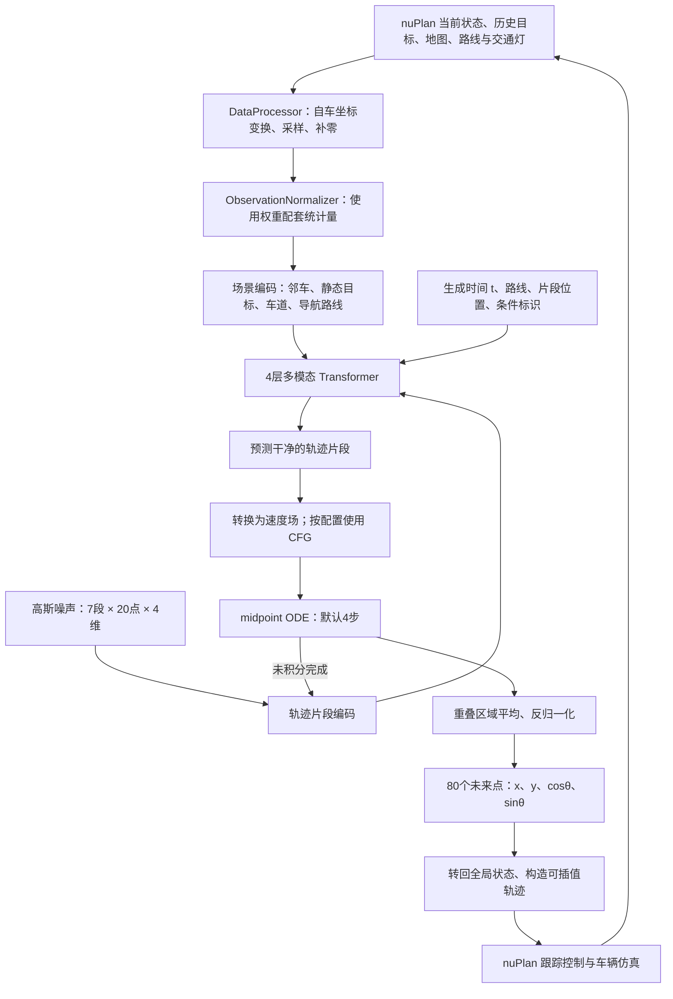

# Flow Planner：从代码理解架构与流程

阅读对象：官方源码提交 `366df7654d7b7fa77f9d2577279da63127c6d2f8` 与作者 Hugging Face 权重版本 `b627934a8db3021892afd13f5278ba0149532efc`。本项目只推理，不重新训练。以下将原论文方法、当前代码行为与本课题的后续扩展分开说明。

## 1. 它解决什么问题

输入已经结构化的道路交通场景，生成自车未来轨迹。它学习“在这类道路和周围交通条件下，驾驶轨迹应是什么样”，不同随机初值可以产生不同候选。

原始方法使用日志示范训练，闭环由 nuPlan 的车辆模型和跟踪控制器执行。模型输出不是方向盘转角或制动力，不能直接等同于低附着联合避障控制器。

## 2. 一次规划的流程

这里存在两个不同的时间：生成时间 `t∈[0,1]` 控制从噪声到轨迹的积分过程；车辆物理时间覆盖未来 8 秒。4 次生成积分步不表示车辆只行驶4步。

## 3. 输入怎样变成 token

默认每次处理一个场景，空余项用零填充并屏蔽。

| 输入 | 原始模型输入尺寸（不含 batch） | 编码方式/作用 |
|---|---|---|
| 周围参与者历史 | 32 × 21 × 11 | 2秒历史加当前时刻；位置、航向、速度、尺寸、类别；MLP-Mixer 后每个目标一个192维 token |
| 静态目标 | 5 × 10 | MLP 编码为192维 token |
| 车道 | 70 × 20 × 12 | 中心线、方向向量、左右边界和交通灯；另有速度限制；MLP-Mixer 编码为192维 token |
| 导航路线 | 25 × 20 × 12 | RouteEncoder 实际取前4维，汇聚为256维条件向量 |
| 待生成轨迹 | 7 × 20 × 4 | 每段展开后经 MLP 编码为256维 token |

场景编码会加入位置/类型信息，并计算 token 间距离，供注意力使用。默认共 `32+5+70+7=114` 个联合交互 token。导航路线通过条件调制注入，不额外计入这114个 token。

注意：数据适配器也构造自车历史和当前状态，但此固定实现的 `extract_encoder_inputs` 未将它们作为独立网络输入，配置 `with_ego_history=false`。不能把本课题需要的车速、侧偏、横摆率和轮胎能力条件视作已经完整实现。

## 4. 为什么分成重叠片段

未来轨迹是80个点，每点表示 `(x,y,cosθ,sinθ)`，通常对应8秒、0.1秒间隔。每段20点、相邻段重叠10点，因此是7段。代码中的 `action` 指轨迹片段，不是实际控制量。

分段使模型能分别表达机动的不同阶段，而不必把8秒全部压进一个 token。相邻段通过训练时的一致性项和推理时的重叠平均衔接。平均位置与航向表示不构成轮胎力、控制速率或车辆稳定性的约束证明。

## 5. Transformer 做什么

每个解码块分别处理交通目标、车道和轨迹三类 token，通过条件归一化注入生成时间、路线等信息，再进行联合注意力与各模态的前馈更新。

注意力带有基于空间距离的偏置，目的是让交通对象之间的关系参与轨迹生成。4个块之后，还有一次轨迹 token 对场景 token 的融合，最终输出每段的20×4维轨迹预测。

编码器192维、解码器256维、4层、8个注意力头。这些是发布模型的结构，不代表后续课题必须沿用相同规模。

## 6. Flow Matching 怎样产生轨迹

理解训练原理有助于理解推理，但本轮不执行训练。条件流匹配将高斯噪声与真实轨迹连接成概率路径。此实现采用 `CondOTScheduler`，插值形式为：

`x_t = (1-t) x_0 + t x_1`。

发布模型直接预测干净轨迹 `x_1`（配置名 `x_start`），再通过库中的 `target_to_velocity` 将其转换为 ODE 所需速度场。对于该路径，速度转换涉及 `(预测x_1 - x_t)/(1-t)`；具体数值行为以固定库实现为准。

推理从随机噪声出发，用 midpoint 积分逐步生成轨迹。每一步 midpoint 需要两次速度场求值，所以默认4步对应8次解码器调用；条件编码只需一次。启用 CFG 时，条件/掩码条件作为同一次解码调用中的两份 batch，不应把“8次调用”和“16份单样本计算”混淆。

## 7. CFG 的意义与发布配置差异

CFG 混合有条件与弱条件速度场：`u=(1-w)u_uncond+w*u_cond`。这里的弱条件主要屏蔽前10个邻车，路线和车道仍保留，所以不等于完全无条件。

随权重发布的配置 `w=1.0`，仓库模型默认配置 `w=1.8`。本轮基线遵循权重配套的1.0。官方规划适配器仍默认 `use_cfg=True`，即使权重1.0也会计算两份分支。关闭 CFG 的加速对照应先检查同噪声输出是否一致，且单独标注为推理设置变化。

固定源码还存在两个需要明确的行为：

- `forward_inference` 的 `cfg_weight` 参数未真正覆盖 `FlowODE` 内存储的权重；本项目在模型实例化前修改配置，保证实验参数实际生效。
- `NuPlanDataSample.repeat` 使用 `repeat_interleave`，而噪声和条件标识使用分组排列。batch大于1时存在样本对应风险。本轮固定单场景batch=1、多候选顺序采样，不对未经验证的多场景batch给出结果。

## 8. 建议阅读顺序

以下均位于 `upstream/Flow-Planner/flow_planner/`：

1. `planner.py`：nuPlan与神经网络的桥梁；读 `initialize`、`compute_planner_trajectory`、`outputs_to_trajectory`。
2. `data/data_process/data_processor.py`：真实场景如何转为张量。
3. `model/flow_planner_model/flow_planner.py`：推理总流程，先看 `forward_inference`。
4. `model/flow_planner_model/encoder.py` 与 `model/modules/encoder_modules.py`：场景编码。
5. `model/flow_planner_model/decoder.py` 与 `global_attention.py`：片段与场景如何融合。
6. `model/flow_planner_model/flow_utils/flow_ode.py` 与 `velocity_model.py`：采样与引导。
7. `model/model_utils/traj_tool.py`、`data/normalization/`：拼接和坐标量纲恢复。

## 9. 对极限避障课题的迁移边界

可借鉴条件 token、多模式候选、重叠片段与少步生成，以及对采样预算的明确计数。

必须补充或重做车辆动态状态/轮胎能力输入、转向制动执行接口、非线性动力学检查、碰撞/道路/执行器/联合轮胎力约束与避障后恢复评价。nuPlan中的成功不能替代这些验证。

资源策略应在完成真实场景推理测量后制定：先考虑紧凑编码器、较短时域/低维控制样条、小批量训练与分阶段数据生产；当实测显存或实验吞吐成为瓶颈，再估算云端服务器需求。当前官方权重推理不构成租用多卡训练服务器的理由，也不能据推理显存推断未来训练成本。

参考：[官方仓库](https://github.com/DiffusionAD/Flow-Planner)、[论文](https://arxiv.org/abs/2510.11083)、[官方权重](https://huggingface.co/ttwhy/flow-planner)。
