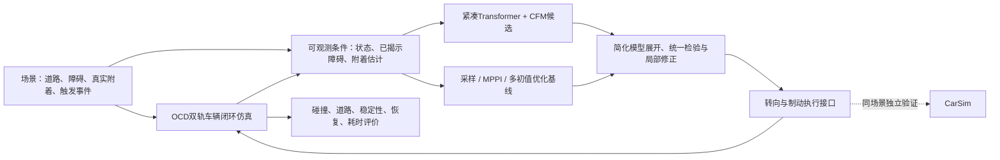

# 极限避障建模：仓库核查与下一阶段任务

评估日期：2026-10-14。依据：`paper_research.md`、`research_roadmap.md`、Flow Planner 本机实验记录，以及本次读取的五个公开仓库目录和44个源文件。此次为源码与接口评估，未安装、编译或运行五个候选项目，也未验证其动力学精度。固定提交、完整文件树、源文件快照和 SHA256 位于 `literature/repository_audit_20261014/`。

## 1. 当前阶段判断

**按“不重训、官方权重、小样本闭环、理解原理”的约定，Flow Planner 最小运行复现已基本完成，可以进入车辆场景建模。** 已完成权重严格加载、推理机制检查、三个真实nuPlan mini闭环场景、指标和动态回放。三场景综合分数0.971951，仅代表该小样本。参见 [实验记录](01_flow_planner/docs/EXPERIMENTS.md)。

尚未完成的是完整论文基准、真实场景采样参数消融及极限动力学验证；这些不应作为进入下一阶段的前置要求。当前nuPlan闭环使用LQR和运动学自行车模型，不能检验联合滑移、低附着稳定性与恢复。合成接口推理约39.5 ms，而真实规划调用均值约239–261 ms，说明迁移时必须重新设计并测量端到端计算链。

课题主问题仍是：**在专家数据少、车辆能力改变时，Transformer＋CFM能否在有限时间内提供更容易验证或修正的有效机动？** 下一阶段应先提供可信的动力学环境、可行性参照和数据来源；直接训练网络会把场景不可行、物理实现错误和学习失败混在一起。

## 2. 五个仓库的固定版本与分工

| 仓库 | 本次固定提交 | 适合承担的角色 | 判断 |
|---|---|---|---|
| Open Car Dynamics | `94f8fb187fb0ed22bba1d809bd74f66d1ff75af4` | Linux车辆仿真后端、候选复核 | 首选，有条件采用 |
| TAMP / SAA-RTI | `866d718114613fcc9e39df336c61b35a66d9e175` | 突现障碍、低附着场景及采样增强优化参考 | 优先迁移场景语义 |
| integrated AEB+AES | `92a3e5489f5d714421e575182c970d91cd6b7be7` | Simulink / CarSim接口及联合控制参考 | 后期验证参考，接口宜提前检查 |
| MPCC | `bd331621ba47ae3326711922a863bdb1cdf2d2ea` | 道路走廊、约束线性化、优化基线参考 | 不宜直接作为完整联合避障基准 |
| general-evasive-driver | `87f1829d37f8210071ae267eaec7b5c4aa56cfb3` | 环境接口、随机化、场景及结果组织参考 | 不作为主要物理依据 |

### 2.1 Open Car Dynamics：工程结构合适，物理适用性需要标定

可确认的功能：

- 车辆动力学、驱动系统、转向执行器分模块组合；提供单轨/双轨、MF52和Python工厂接口。官方支持Ubuntu 22.04/24.04，C++20，CMake、Eigen、Boost；Python官方构建路径使用ROS 2/colcon或Docker。纯CMake入口用于C++库，不能把它当作Python绑定的一键安装入口。[官方构建说明](https://github.com/TUMFTM/Open-Car-Dynamics/blob/94f8fb187fb0ed22bba1d809bd74f66d1ff75af4/README.md)
- MF52确实调用纵、横向联合滑移函数，而非只有横向饱和。[MF52源码](https://github.com/TUMFTM/Open-Car-Dynamics/blob/94f8fb187fb0ed22bba1d809bd74f66d1ff75af4/lib/ocd_tire_models_cpp/src/mf_52.cpp)
- `ExternalInfluences.lambda_mue`为四轮独立数值，默认均为1，Python绑定开放该字段。双轨模型将其乘在各轮MF52计算出的纵、横向力上。因此可以通过外部适配器实现前后轮依次进入湿滑区、左右分离附着；仓库本身没有替我们完成道路查询。[数据类型](https://github.com/TUMFTM/Open-Car-Dynamics/blob/94f8fb187fb0ed22bba1d809bd74f66d1ff75af4/lib/ocd_types_cpp/include/ocd_types_cpp/types.hpp)、[轮胎力计算](https://github.com/TUMFTM/Open-Car-Dynamics/blob/94f8fb187fb0ed22bba1d809bd74f66d1ff75af4/lib/ocd_vehicle_dynamics_double_track_cpp/include/ocd_vehicle_dynamics_double_track_cpp/vehicle_dynamics_equations_impl.hpp)
- 转向PT1模型具有时间常数、角度和角速度限制。`FX`驱动输入为纵向力请求，负值按前后制动比例转换为制动力矩；另有四轮直接转矩输入。请求不等于地面实际纵向力。[转向执行器](https://github.com/TUMFTM/Open-Car-Dynamics/blob/94f8fb187fb0ed22bba1d809bd74f66d1ff75af4/lib/ocd_steering_actuator_pt1_cpp/src/steering_actuator_pt1_model.cpp)、[FX输入映射](https://github.com/TUMFTM/Open-Car-Dynamics/blob/94f8fb187fb0ed22bba1d809bd74f66d1ff75af4/lib/ocd_drivetrain_fx_cpp/include/ocd_drivetrain_fx_cpp/drivetrain_fx_model.hpp)

需要补齐的内容：

1. **车辆参数。** 作者明确说明真实AV21的重要参数保密，默认配置是通用单座赛车和运动型公路轮胎。不能把默认配置直接称为经过验证的乘用车。应选定一辆目标车，冻结质量、轴距、惯量、质心、轮胎、制动分配与转向参数，再与后续CarSim对应。
2. **附着定义。** `lambda_mue`是力缩放系数，不是天然等于道路绝对摩擦系数μ。其简单缩放也不等价于湿地轮胎曲线的全面重新辨识。需要在选定轮胎参数、轮荷和滑移范围下标定，并区分纵横向峰值及载荷依赖。不能直接把TAMP的μ写入该字段后声称物理一致。
3. **制动与低速。** 明确最大制动力矩、建立时间、制动分配、轮速/滑移限制以及是否实现ABS。四轮转矩输入只说明接口存在，不等于已有乘用车完整制动控制。尤其要验证紧急制动至停车时的低速数值处理。
4. **训练接口。** 抽查的Python接口是普通C++状态推进绑定，没有提供PyTorch自动微分链。可用于无梯度仿真、筛选和评价；若训练损失要穿过动力学反传，需要另建可微简化模型或采用无梯度评分数据。

推荐起步组合为双轨＋MF52＋PT1＋FX请求接口，先统一前后制动比例、左右对称；是否转为直接四轮转矩取决于后续轮端分配研究。不要一开始把四轮独立控制、附着估计和生成规划都列为创新点。

### 2.2 TAMP：场景契合，但需脱离旧仿真栈迁移

`popup_dry_config.yaml`、`popup_wet_config.yaml`和`reduced_mu_turn_config.yaml`提供突现位置、障碍位置、沿道路弧长的分段附着、速度参考及算法开关。`experiment_manager.py`负责按位置发布障碍、改变仿真轮胎参数和管理实验。原运行依赖Ubuntu 16.04、ROS Kinetic、Python 2.7、作者FSSIM分支及ACADO分支。[README](https://github.com/larsvens/tamp_ws/blob/866d718114613fcc9e39df336c61b35a66d9e175/README.md)、[场景配置](https://github.com/larsvens/tamp_ws/tree/866d718114613fcc9e39df336c61b35a66d9e175/common/config)、[实验管理器](https://github.com/larsvens/tamp_ws/blob/866d718114613fcc9e39df336c61b35a66d9e175/common/scripts/experiment_manager.py)

源码核查带来的三个修正：

- 原管理器按照自车弧长选择一段μ，再发布一套轮胎参数；不能把它视作现成的二维、四轮接地点路面模型。将其扩展到`mu(x,y,t)`并逐轮查询，是本课题新增工作。
- 原管理器随μ区间改变简化轮胎的B/C/D/E；OCD的外部接口直接缩放轮胎力，二者不能机械对应。优先复用道路几何、附着区域和触发规则，重新验证轮胎能力映射。
- 提交中的`popup_wet_config.yaml`和`reduced_mu_turn_config.yaml`都设置了`sampling_augmentation: 0`、`traction_adaptive: 0`。这些可用于对照，但不是开启全部能力的配置；正式实验必须保存实际开关。

建议建立独立Python 3场景格式，不以修复整套ROS 1/CUDA/ACADO旧栈为第一目标。若以后需要严格复现SAA-RTI数值结果，再单独隔离旧环境。自己移植采样增强思想时应称“参考TAMP的基线”，不能称已复现原算法。

### 2.3 integrated AEB+AES：接口存在，运行材料尚不闭合

目录中有MATLAB场景、ZOH/FOH控制模型，以及`controller_for_carsim/withROS`与`withoutROS`两条路径。因此软件联合仿真可以先考察不带ROS的版本，不必把Jetson硬件列为这一子任务的前提。[官方说明](https://github.com/dekunw/integrated_AEB_AES/blob/92a3e5489f5d714421e575182c970d91cd6b7be7/README.md)

本次将`withoutROS/controller_for_carsim.slx`作为ZIP静态检查：元数据为MATLAB R2021a；顶层引用`Solver_SF/CarSim S-Function2`；`SIMFILE`为`simfile.sim`。当前完整仓库文件树没有该文件，也未看到对应的完整CarSim数据包。可确认有接口骨架，不能确认可直接重现原CarSim实验。[已检查的SLX文件](https://github.com/dekunw/integrated_AEB_AES/blob/92a3e5489f5d714421e575182c970d91cd6b7be7/controller_for_carsim/withoutROS/controller_for_carsim.slx)

应在Windows端提前做一次短检查：本机版本能否加载S-Function、能否自行导出有效simfile、输入通道是转角/制动力/压力/力矩中的哪一种、单位和符号是否一致。最终论文阶段再开展批量对照。模型版本众多，不能把R2021a这个抽查结果推广到所有SLX。

FOH参数脚本的操纵量还包含`Fyf`与`Mx`等广义力，不能未经执行器分配就等同于本课题的方向盘/制动请求；接口必须以实际选用模型为准。[参数脚本](https://github.com/dekunw/integrated_AEB_AES/blob/92a3e5489f5d714421e575182c970d91cd6b7be7/FOH/controller_setup.m)

### 2.4 MPCC：适合借鉴优化方法，必须改造物理和任务

提供非线性自行车、车道边界、输入/变化率约束，以及基于绕障走廊的控制；作者明确说明避障功能仅在MATLAB版本。C++模型抽查中前轴纵向力设为0、后轴驱动力与横向Magic Formula分别计算、法向载荷为静态分配；其约束代码另加后轴摩擦椭圆与前轴侧偏角约束。因此不能说它“完全没有轮胎能力约束”，也不能把该预测模型视作完整四轮联合制动执行模型。[README](https://github.com/alexliniger/MPCC/blob/bd331621ba47ae3326711922a863bdb1cdf2d2ea/README.md)、[模型](https://github.com/alexliniger/MPCC/blob/bd331621ba47ae3326711922a863bdb1cdf2d2ea/C%2B%2B/Model/model.cpp)、[约束](https://github.com/alexliniger/MPCC/blob/bd331621ba47ae3326711922a863bdb1cdf2d2ea/C%2B%2B/Constraints/constraints.cpp)

可参考走廊、局部线性化和求解流程；作为本课题基线时须改变最大进度目标，加入紧急制动、附着变化和终端恢复，并使用统一车辆后端复核。第一版也可直接自建小型NMPC/MPPI，避免完整移植赛车工程。

### 2.5 general-evasive-driver：保留工程参考，更新对其范围的认识

当前版本不只包含最早的单轨模型，还存在四轮简化模型及Project Chrono后端文件。因此不能根据旧版抽查说整个仓库“只有一个单轨模型”。但抽查的主`env.py`仍实例化`SingleTrackDriftModel`；该模型使用静态前后轴载荷，制动与驱动合并为后轴纵向力、后轴摩擦圆剩余容量限制横向力。四轮文件也明确定位为紧凑故障场景挖掘原型，使用静态轮荷。[主环境](https://github.com/EdwardOptimization/general-evasive-driver/blob/87f1829d37f8210071ae267eaec7b5c4aa56cfb3/src/autodrift/env.py)、[单轨模型](https://github.com/EdwardOptimization/general-evasive-driver/blob/87f1829d37f8210071ae267eaec7b5c4aa56cfb3/src/autodrift/dynamics.py)、[四轮模型](https://github.com/EdwardOptimization/general-evasive-driver/blob/87f1829d37f8210071ae267eaec7b5c4aa56cfb3/src/autodrift/four_wheel_dynamics.py)

Chrono接口存在不代表该仓库整体物理模型及实验已被独立验证；本次没有运行其后端或核验所有实验记录。可借鉴Gymnasium接口、随机化、固定种子和结果管理；不建议新增整套RL训练作为本课题前置任务。[Chrono后端](https://github.com/EdwardOptimization/general-evasive-driver/blob/87f1829d37f8210071ae267eaec7b5c4aa56cfb3/src/autodrift/chrono_vehicle_backend.py)

复用声明记录：OCD和MPCC为Apache-2.0，TAMP为MIT；本次GitHub元数据及文件树未找到AEB+AES和general-evasive-driver明确的仓库许可证。实现自己的场景/接口时应保留来源记录，不能把后两者默认为有明确再分发许可。

## 3. 建议的平台结构

需要区分**预测模型**与**被控车辆仿真模型**。前者用于快速批量展开和优化，第一版可采用带联合力限制、纵向载荷转移和执行器状态的非线性自行车；后者用OCD双轨/MF52检验模型失配。不必把OCD完整状态直接塞进CFM，也不应假设所有候选都需要用最复杂模型全时域展开。OCD可复核少量候选并承担闭环执行，具体划分由耗时与误差试验确定。

真实附着`mu_true(x,y,t)`与给规划器的估计`mu_hat`应分开。第一阶段可显式采用已知附着以隔离规划问题，随后加入估计偏差/滞后。突现障碍同样区分物理存在和被规划器观察到的时刻，避免未来信息泄漏。

## 4. 下一阶段任务与验收

建议后续另建`02_extreme_avoidance/`，保留`01_flow_planner/`作为冻结参照。本次只做评估，尚未建立或安装这一环境。

| 顺序 | 任务 | 完成标准 |
|---|---|---|
| A | 冻结接口和一套车辆参数，构建OCD独立环境 | 能reset/step、导出状态/轮胎力/轮荷/滑移/控制请求与实际执行；单位、坐标、时间步一致 |
| B | 做动力学校验 | 直线制动、稳态转弯、转向叠加制动、附着切换、停车；减半积分步长后关键指标收敛；左右对称工况响应合理 |
| C | 建立三个场景模板 | 直路突现障碍＋均匀附着；无障碍弯道附着下降；弯道障碍＋低附着。先完成第一个，再组合复杂条件 |
| D | 接入共同基线与判定器 | AEB、简单转向避让、联合采样/MPPI或多初值NMPC；用同一执行器和车辆模型评价 |
| E | 形成第一批可信数据 | 保留左右绕行和不同时序的合格候选；记录求解失败、模型复核失败、成本和成功模式，不只保存最好一条 |
| F | 进入紧凑CFM研究 | 先比较稀疏模仿、能力条件化、物理筛选/修正；再做预算分配和泛化，避免同时改动所有组件 |

场景参数至少包括：道路中心线和边界、初始位置/速度/侧偏/横摆、障碍几何与运动、揭示规则、路面附着场、车辆参数、控制延迟、终止条件与随机种子。碰撞和道路判定使用车辆外形，考虑离散步之间的扫掠，不能只检查质心点。

第一轮可试验10/15/20/25 m/s与若干高低附着档位，但这只是扫描起点，不能把所有组合标为“极限”。应在每组车辆、道路和附着条件下逐步缩短障碍揭示距离，识别：纯制动足够、需要转向/联合机动、仅少数模式可行、尚未找到可行解等区域。`v²/(2μg)`只可作平直路理想制动初筛，实际边界由延迟、轮胎、制动和道路共同决定；多初值优化失败仍只能标“可行性未知”。

验收要求应覆盖完整避障和恢复：无碰撞、车身未越界、执行器限制满足、侧偏/横摆可恢复、最终能够沿道路继续行驶或稳定停车。紧急时可容许的舒适性和暂态侧偏应事先定义，不宜直接照搬普通驾驶评分，也不能将“发生轮胎饱和”本身判为失败。恢复阈值由车辆校验确定，并要求连续保持一段时间。

## 5. 任务与课题难点

| 难点 | 对课题的影响 | 优先处理方式 |
|---|---|---|
| 物理参数与附着映射可信度（高） | 错误的力边界会制造虚假的可行轨迹和算法优势 | 轮胎力曲线、制动距离、联合操纵及步长收敛检查；参数冻结 |
| 控制请求到实际轮胎力（高） | 生成的转角/制动不一定可执行，过强制动也可能挤占横向能力 | 执行器动态、轮速/滑移和制动分配显式建模；统一底层控制 |
| 可行边界与多模式标签（高） | 单初值失败会被误记为不可行，数据只覆盖一侧绕行 | 采样＋多初值优化，临界区重点补数；未知与已验证可行分开 |
| 避障后的恢复（高） | 绕过障碍后仍可能持续失稳或出界 | 延长评估到恢复阶段，统一终端和保持时间要求 |
| 少数据生成学习（高，研究主体） | 稀疏样本易丢失可行分支，物理损失也可能偏向单一模式 | 同一专家成本下做能力条件、物理反馈、主动补数消融；报告数据成本而非仅轨迹条数 |
| 预测模型与OCD/CarSim失配（高） | 在训练模型中有效，换车辆后端失败 | 两级模型、独立后端验证，分析误差来源及参数扰动 |
| 严格在线预算（中高） | 网络快但检验、修正或传输超时，仍不可用 | 统计完整流程P95/P99、超时率、首次有效候选时间；统一回退策略 |
| 工程集成（中） | 旧ROS、Python ABI、CarSim通道与版本可能耗时 | 独立环境、统一适配层、小规模接口检查；不同时维护五套完整系统 |

课题贡献应检验“相同专家成本下临界场景更少失败”或“相同在线预算下更容易获得可执行候选”，而不是仅证明组合软件能运行。比较方法必须共用场景、可观测条件、车辆执行、底层制动控制、时间预算和判定标准。训练/测试按场景家族或基础条件划分，避免同一场景的相邻切片跨集合。

## 6. 当前计算资源与租用判断

本次本机检查：Ubuntu 22.04.5、i9-14900（24核32线程）、约64GB内存；GPU沿用已验证的RTX4090 24GB。本次未重新运行GPU测试。

**足以启动场景与车辆建模，现阶段没有租用更大GPU服务器的必要依据。** OCD是C++车辆仿真库，第一阶段主要消耗CPU；高精度多初值优化的数据生成也可能先受CPU并行与求解耗时限制。不能把C++库有Python绑定误认为能自动在4090上批量运行动力学。

低资源路线：无图形界面仿真、结构化真值、少量场景模板、两级动力学、短控制序列/样条参数化、先筛选后复核；未来CFM先用百万级参数的紧凑模型和小批量起步。具体显存与训练时间以试跑为准，Flow Planner推理显存不能用于推断新模型训练成本。含可微展开时还需计入保留状态和梯度的内存。

建议先做固定规模的小批数据生成与短训练试跑，测量每场景求解耗时分布、可行候选产率、并行效率、GPU训练峰值和每轮耗时，再按总场景数、每场景初值数与有效并行度外推。只有CPU数据生成成为工期瓶颈才优先考虑更多CPU核/内存；只有GPU显存或训练总时长成为瓶颈才考虑更大显存或多卡。租用方案应基于这些实测数据另行给出，而非现在按大模型论文配置采购。

## 7. 本次核查产物

- `literature/repository_audit_20261014/<repo>/metadata.json`：固定提交、分支、提交日期与许可证字段。
- `tree.json`、`paths.txt`：完整仓库文件清单；五个API文件树均未截断。
- `sources/`：本次选择读取的关键文件，不是完整克隆，也没有执行其中代码。
- `source_manifest.json`：44个文件的下载地址、长度与SHA256。
- `carsim_slx_inspection.json`：本次SLX静态接口检查结果。

推荐决策：**采用OCD作为Linux车辆仿真后端，迁移TAMP场景定义并补齐逐轮路面映射，建立独立简化预测模型与统一评价，CarSim负责后续独立验证。** 接下来的第一个里程碑是“物理与场景可信、传统基线能闭环”的小平台，然后再开展紧凑Transformer＋CFM的少数据研究。
