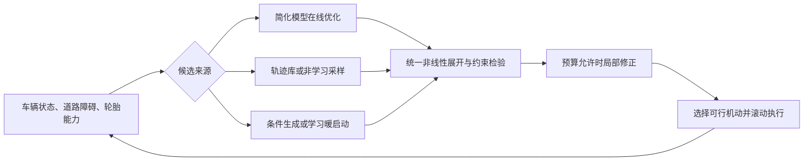

# 少专家数据与严格在线预算下的生成式极限避障：文献调研与研究问题

调研日期及修订日期：2026-10-12。范围：高速、低附着及接近轮胎力极限时，有限在线计算预算下的转向—制动联合避障。本次完成文献整理、开源代码可复现性核查与研究路线设计，未运行控制器、生成专家数据或开展性能实验。按研究者最新意图，生成式方法与 Transformer 是本课题预定技术路线；研究重点转向如何使该路线在专家数据受限、动力学能力变化和严格计算截止时间下有效。开源项目筛选和起步方案见第 11 节及 [research_roadmap.md](research_roadmap.md)。

## 1. 主要判断

**本课题采用 Transformer 条件编码与生成式机动建模，优先探索 CFM；核心任务是解决该路线在少专家数据和严格在线预算下的有效性问题。** 不把“先证明生成方法全面优于传统优化”设为选题前提，也不将尚未验证的优越性写成采用理由。传统方法承担物理参照、数据来源、修正后端及比较基线的角色。

建议将研究对象定义为**少专家数据下动态能力条件化的多模式机动生成与预算受限验证**。生成模型表示候选分布，Transformer 融合车辆、道路障碍与轮胎能力，非线性展开及局部修正检验可执行性。现有文献为这个组合提供构件，但尚未直接验证本课题的整体效果。R01 的模型展开训练、R02 的评分蒸馏和 R18 的无示范搜索表明，高精度最优动作标签可以被部分替代；它们并不证明不需要任何有效数据或物理模型。

证据链分为三层：车辆论文证明轮胎约束变化、模型选择和恢复阶段会实质影响控制问题；通用生成式与驾驶论文证明分布学习、引导和候选搜索能够在其测试任务中发挥作用；两者之间仍缺少覆盖低附着、轮胎联合滑移、执行器约束与避障后恢复的同预算闭环比较。这个交叉处是本课题可检验的研究空间，但本次检索不能构成“全球尚无同类工作”的完备新颖性证明。

### 1.1 科学问题与技术目标

“数据少”和“计算快”本身是资源约束，还需要凝练为机制问题。建议主科学问题为：**当专家样本只稀疏覆盖可行域，而动态状态与轮胎能力又改变机动模式及其可行区域时，如何利用条件生成与物理反馈，在有限推理预算内保持对有效机动模式的覆盖？** 对应两个子问题：如何利用低成本可行数据、动力学展开和少量高精度标签减少专家需求，同时避免模式丢失；如何根据候选的可行余量及修正难度，在生成、验证和局部修正之间分配有限计算。

由此提出三个待验证假设。H1：在相同专家生成成本下，能力条件化及物理反馈比单纯模仿少量精确解更能维持已发现可行模式的覆盖。H2：按问题难度分配生成与修正预算，比固定步数、固定候选数更容易在截止时间内得到至少一个有效机动。H3：混合精度数据加临界区域主动补数，可以降低达到指定闭环成功水平所需的高精度标签量。三者都是本课题拟检验的假设，不能作为现有事实引用。

### 1.2 采用生成式方法与 Transformer 的理由

生成分布适合表达左右绕行、制动与转向时序等不同机动分支，可为后端提供多个初值，并允许在测试时依据新能力边界筛选或修正。这些是任务与方法之间的结构性契合，不意味着分支越多越好；仅在一个机动可行时，不应强行生成无效的“多样性”。Transformer 则适合把不同数量的障碍物、道路片段和前后轴/轮胎能力信息编码为异质 token，并建立其相互关系。对于仅含少数固定状态量的简单任务，Transformer 的额外复杂度并不自动合理，因此仍保留 MLP 或较小编码器的诊断性消融。

课题可以不以全面超越传统方法为唯一贡献。例如，在达到相近成功率时减少昂贵专家成本，在相同截止时间下改善临界场景的首次可行命中率，或揭示模型简化和生成误差如何共同导致特定模式丢失，都具有研究价值。必须在实验前确定主要指标和适用场景；若这些具体收益均未得到支持，应如实限制结论，不能事后把“采用新架构”本身当作贡献。

## 2. 文献来源、筛选与证据等级

从 Zotero 的 `transformer` 集合开始，集合键为 `VJBUHAEE`。初始共有 8 条论文记录，去重后为 6 篇独立文献，不计附件；R01 和 R02 各有两条记录。本次保留这些原始记录，没有删除或合并。读取了这 6 篇的 Zotero 索引全文；R04 同时读取补充材料。无法从现有记录可靠识别你具体精读了哪几篇，因此没有替你标注“已精读”。

互联网检索使用英文关键词组合，包括 `emergency obstacle avoidance combined braking steering nonlinear MPC`、`traction adaptive limits of handling`、`particle model optimal collision avoidance`、`flow matching autonomous driving planning`、`diffusion trajectory optimization without demonstrations` 和 `imitation learning distribution shift`，并追踪原始论文、官方会议论文集、作者项目页和高校文献库。筛选重点是能回答本课题四项前期问题的原始研究；不以搜索排名、自动摘要或“SOTA”宣传作为结论依据。最终保留原库 6 篇与补充 17 篇，共 23 篇。这是有针对性的范围调研，不是具有完备召回率的系统综述。

下文 A 表示已核查论文全文中的相关方法和实验段落，B 表示主要核查官方摘要、书目信息或部分正文，C 表示综述背景。A 不表示已复现，也不表示论文所有结论都经过独立验证。未核实的数据规模、硬件耗时或算法细节明确留空，不从摘要补造。作者报告的频率仅适用于对应硬件、实现和测试条件，不能跨论文直接比较。

## 3. 原 transformer 集合逐篇分析

### R01｜Off-road distributed-drive electric vehicle trajectory tracking control with constrained Transformer MPC

Zhang 等，Control Engineering Practice 165，106608，2025；[原文 DOI](https://doi.org/10.1016/j.conengprac.2025.106608)。证据 A。Zotero 原记录：`TPSPHJMA`、`TWJQ3VWJ`，全文附件：`MS2SXXC8`、`YN2UH497`。

**主要问题与架构。** 研究带复合坡度和侧翻风险的分布式驱动电动车轨迹跟踪，建立包含纵向、横向、横摆和侧倾的四自由度模型。Transformer 编码车辆状态、预测时域内的参考轨迹与道路坡度，输出前轮转角和四轮转矩序列。

**训练方式与数据来源。** 第 4.2 节及式 (11)–(16) 直接把预测时域代价写成策略参数的损失，通过车辆动力学展开计算，采用增广拉格朗日方式处理状态约束，使用饱和映射约束控制幅值。初始状态由参考轨迹采样并叠加高斯误差得到。它不是先求解大量 MPC 最优动作标签再监督回归的标准模仿学习；参考轨迹仍是必要输入。验证包括 CarSim 联合仿真和实车越野跟踪。

**对本课题的启发与边界。** 这是“不一定需要逐场景最优示范”的直接车辆证据，可以作为模型展开训练的确定性策略基线。论文的跟踪、稳定性和计算量结果不能直接外推到障碍左右绕行的多模态决策，也不能把训练中的约束惩罚当作所有分布外场景的硬可行性保证。正文式 (13) 的更新记号不够标准，复现时应以实现或作者澄清确定更新过程；仅凭该式不宜作收敛承诺。

### R02｜Driving policy distillation in autonomous racing with adaptive racing vocabulary and optimal driving guidance

Lee 等，Expert Systems with Applications 296，129191，卷期年 2026，在线发表于 2025；[原文 DOI](https://doi.org/10.1016/j.eswa.2025.129191)。证据 A。Zotero：`TLXKHFP7`、`CC4LZ3TG`，全文：`RPDZ9HJV`、`J2XCN2DN`。

**主要问题与架构。** 根据赛道几何和车辆状态构建自适应轨迹词表，Transformer 融合场景与候选轨迹，多个代价头估计可跟踪性、稳定性、比赛线误差、碰撞和出界等指标，再组合评分选轨迹，由底层控制器执行。

**训练方式与数据来源。** 第 3.3 节并不是对每个场景求一个完整最优动作序列作为标签。候选轨迹的动力学可跟踪性由非线性自行车模型及 Stanley/PID 跟踪展开评估，横向轮胎力使用 Magic Formula；比赛线误差依据离线比赛线，碰撞与出界依据几何评估。多个评分头以这些伪真值代价进行 MSE 训练。数据由规则代价选择的仿真驾驶采集，实验采用 CarMaker 的 Yongin Speedway 场景；单 RTX 3090、100 epochs、约两小时是该文配置，不是本课题成本估算。

**对本课题的启发与边界。** 可以学习“哪些候选更值得验证”，而不必学习精确最优控制。该文仍依赖模型、参考比赛线和仿真数据，不能称为无专家知识；分开的横纵向跟踪及其轮胎处理也不等同于完整的低附着联合滑移避障模型。特别适合作为“低成本候选库＋学习排序＋非线性检验”的比较路线。

### R03｜Flow Matching-Based Autonomous Driving Planning with Advanced Interactive Behavior Modeling

Tan 等，NeurIPS 2025，Flow Planner；[官方实现与论文入口](https://github.com/DiffusionAD/Flow-Planner)。证据 A。Zotero：`GTUYFM7K`，全文：`ARZAR8JY`。

**主要问题与架构。** 解决交通交互中的条件多模态规划，将未来轨迹分为有重叠的片段 token，以时空注意力融合自车、邻车和车道条件。用 flow matching 学习轨迹分布，并通过邻车条件掩码训练 classifier-free guidance。第 3.3–3.4 节采用轨迹预测重参数化、重叠片段一致性损失，以及初始自车状态扰动和五次多项式重构的数据增强。

**训练方式与数据来源。** 使用 nuPlan 1M split 的真实驾驶日志，闭环测试覆盖 nuPlan 和 interPlan；仿真执行使用 LQR 控制器。附录 C 报告 8 张 A6000、batch 2048、超过 200 epochs；推理使用四个 midpoint ODE 积分步，约 12 Hz。四步积分不等于四次网络前向，也不意味着完成整个控制流程仅需四步。

**对本课题的启发与边界。** 可借鉴分段 token、多模态输出、条件融合与条件强度调节。训练样本是日志示范而非逐场景全局最优控制解，说明 CFM 不以数学最优标签为定义要求。但常规道路交互与轮胎极限机动是不同分布，LQR 闭环分数不能证明低附着可行性；五次多项式增强也需要重新做轮胎与执行器检验。不能直接套用百万样本和大模型规模。

### R04｜Safety-Enhanced Autonomous Driving Using Interpretable Sensor Fusion Transformer

Shao 等，CoRL 2022 / PMLR 205，726–737，论文集发表于 2023，InterFuser；[官方论文与补充材料](https://proceedings.mlr.press/v205/shao23a.html)。证据 A。Zotero：`MQ6M4XIZ`，全文：`3P6FT6QL`，补充：`P2PN4756`。

**主要问题与架构。** 用 Transformer 融合多视角图像与激光雷达，输出带语义的中间场景表示及驾驶相关预测，再以这些可解释信息约束后续动作。CARLA 规则专家使用仿真特权信息采集约 300 万帧、410 小时数据；监督目标包括路径点、对象密度图和交通规则，之后经 PID 与安全控制器执行，验证是 CARLA 驾驶基准。

**对本课题的启发与边界。** 值得借鉴的是把学习表征与可检验条件连接起来，而不是把全部安全责任交给黑箱输出。若本课题已经给定障碍物、道路和车辆状态，则不宜把完整视觉融合网络加入首轮研究，否则感知误差会干扰动力学问题。该文没有给出轮胎联合力极限或避障恢复域的验证。

### R05｜Learning to Race Full-Scale Autonomous Racecars

Eric Berndt，UC Berkeley 技术报告 / 硕士论文 UCB/EECS-2025-120，2025；[高校原始记录](https://www2.eecs.berkeley.edu/Pubs/TechRpts/2025/EECS-2025-120.html)。证据 A。Zotero：`F7VLDEX6`，全文：`PUG6B9GM`。

**训练、数据与架构。** 从 GPS 地图生成赛道，使用样条最小曲率方法构建比赛线，再由 MPC 在仿真中跟踪；加入动作噪声扩大状态分布，以状态—动作数据训练因果 Transformer 预测转向与驱动力。其专家链是“比赛线生成＋MPC 跟踪”，不是对所有状态和障碍进行完整联合全局最优求解。

**问题、启发与边界。** 展示将在线控制计算转移到离线训练的可行路径，动作扰动与多步预测可用于考虑覆盖和延迟。必须分清：约 320 km/h 是所用赛车的能力描述，仿真中匹配专家至约 193 km/h，报告的实车零样本部署约 64 km/h。它不能支持“学习策略已经完成 320 km/h 实车验证”，也没有直接验证突发低附着障碍避让。

### R06｜Transformer-Based Autonomous Driving Models and Deployment-Oriented Compression: A Survey

Zhong 等，arXiv:2304.10891，首版 2023，本次核对最新 v4 为 2026-08-28；[版本与原文](https://arxiv.org/abs/2304.10891)。证据 C，已读本地索引全文。Zotero：`37NAPNZE`，全文：`T7ZBUX6J`。

**内容及适用方式。** 这是综述，没有一个统一的自有训练方式或数据库。文章整理感知、预测、规划中的 Transformer，以及量化、剪枝、蒸馏和高效注意力等部署方法。对本课题最有用的是把延迟、显存和硬件约束纳入设计；它不能作为 CFM 在轮胎极限工况优于优化的原始实验证据。引用时需锁定版本，不能把 2026 年修订内容全部归到 2023 年已知结果。

## 4. 补充文献：车辆动力学、简化模型与传统搜索

### R07｜Adaptive Trajectory Planning and Optimization at Limits of Handling

Svensson、Bujarbaruah、Kapania、Törngren，2019；[作者公开论文](https://arxiv.org/abs/1903.04240)。证据 A，核查公开 PDF 的方法相关部分。

**训练与数据库。** 无生成式训练，也不要求专家示范；输入是车辆、道路、障碍与附着条件。**架构与问题。** 以随附着条件更新的轮胎力约束构造有限时域优化，使用 Sampling Augmented Adaptive RTI，在 RTI-SQP 前补充可行候选，减轻局部极小和约束突变问题。证据来自数值仿真。**启发。** 本课题要检验的是学习候选能否比这种非学习采样更有效，不能只与冷启动、单初值 NMPC 比较。

### R08｜Traction Adaptive Motion Planning and Control at the Limits of Handling

Svensson 等，IEEE Transactions on Control Systems Technology 30(5)，1888–1904，2022，在线发表于 2021；[正式记录与公开全文](https://research.chalmers.se/publication/527880)，[DOI](https://doi.org/10.1109/TCST.2021.3129373)。证据 A。arXiv:2009.04180 是较早版本，正式题名多了 “and Control”，不能当成两篇独立证据重复计数。

**训练与数据库。** 无示范学习；预测附着和动态轮荷决定时变轮胎力边界。**架构与问题。** 将受约束滚动优化与 GPU 加速候选采样结合，处理附着突变及局部极小，在 Volvo FH16 重型车上实验。**启发与边界。** 这是本课题最重要的直接基线：动态能力本身必须进入规划。其车辆、参数化和轮胎边界近似不等于目标乘用车模型，实车证据也不替代目标平台重验证。

### R09｜Modified Hamiltonian Algorithm for Optimal Lane Change with Application to Collision Avoidance

Gao、Lidberg、Gordon，MM Science Journal，2015；[期刊原文](https://www.mmscience.eu/journal/issues/march-2015/articles/modified-hamiltonian-algorithm-for-optimal-lane-change-with-application-to-collision-avoidance)，[DOI](https://doi.org/10.17973/MMSJ.2015_03_201508)。证据 B，核查期刊摘要与 PDF 部分正文。

**训练与数据库。** 无学习数据库。**架构与问题。** 质点模型给出全局质心加速度参考，随后结合横摆力矩，利用对轮胎力呈线性的 Hamiltonian 进行局部轮端分配，以降低计算负担。**启发与边界。** 直接支持“低阶参考生成＋车辆动力学处理”是应认真比较的路线；它不是本课题拟议简化在线 OCP 流程的完全同一实现，也没有证明质点几何可行就必然能被轮胎受限车辆执行。

### R10｜Models and methodology for optimal trajectory generation in safety-critical road–vehicle manoeuvres

Berntorp、Olofsson、Lundahl、Nielsen，Vehicle System Dynamics 52(10)，1304–1332，2014；[高校原始记录](https://portal.research.lu.se/en/publications/models-and-methodology-for-optimal-trajectory-generation-in-safet/)，[DOI](https://doi.org/10.1080/00423114.2014.939094)。证据 B。

**训练、数据与问题。** 无策略训练；通过不同车身与轮胎模型求解最短时间机动，比较模型复杂度对解的影响。官方摘要指出轮胎模型显著改变最优控制输入，而部分高层变量在某些模型配置下相似。**启发与边界。** 不能用“模型更高阶”自动推导“专家标签更好”。专家质量取决于模型辨识、约束和目标是否对应真实任务；优化解是模型内结果，且本次未核实可供估算大规模数据生产成本的逐实例耗时。

### R11｜Analysis and design of recovery behaviour of autonomous-vehicle avoidance manoeuvres

Anistratov、Olofsson、Nielsen，Vehicle System Dynamics 60(7)，2231–2254，2022，在线发表于 2021；[高校原始记录](https://portal.research.lu.se/en/publications/analysis-and-design-of-recovery-behaviour-of-autonomous-vehicle-a/)，[DOI](https://doi.org/10.1080/00423114.2021.1900577)。证据 B。

**训练与数据。** 无学习数据库，以双移线仿真与优化分析为证据。**架构与问题。** 分析避障后的恢复过程和轮端转矩分配冗余，逐步改进优化指标，讨论车道偏离、最短时间和横向误差平方等目标。**启发。** “绕过障碍”必须与“能恢复正常行驶”一起评价；这可成为本课题的核心物理要求。本文摘要不足以确定适用于本车的终端稳定域，具体恢复域须另外建立。

### R12｜Information Theoretic Model Predictive Control: Theory and Applications to Autonomous Driving

Williams、Drews、Goldfain、Rehg、Theodorou；本次使用 2017 作者预印本；[原文](https://arxiv.org/abs/1707.02342)。证据 B，方法和实验定位核对。

**训练与数据。** 控制搜索无需最优示范；车辆预测模型若需辨识，其系统辨识数据与最优动作标签是两类需求。**架构与问题。** 以信息论形式得到采样式 MPC，在动力学展开后按代价更新控制分布，并与 CEM 控制比较，任务包含土路激烈驾驶。**启发与边界。** 提供不学习轨迹先验的并行搜索基线。采样和代价惩罚本身不自动给出硬安全保证；应与生成模型共用同一非线性检验器，公平比较样本利用率。

## 5. 补充文献：生成式规划、数据替代与闭环改进

### R13｜Flow Matching for Generative Modeling

Lipman、Chen、Ben-Hamu、Nickel、Le，ICLR 2023，预印本 2022；[作者论文](https://arxiv.org/abs/2210.02747)。证据 B。

**训练、数据与架构。** 通过固定条件概率路径上的向量场回归训练连续归一化流，原始实验主要是图像数据，不是车辆专家库；推理通过数值 ODE 积分完成。**问题与启发。** 支持用简单的回归目标学习从噪声到目标样本分布的输运。这里的“simulation-free training”指不必训练时反复模拟整个生成 ODE，不意味着车辆动力学或数据生成无需计算；FM/CFM 也不要求目标样本必须为最优解，更不自带车辆约束保证。

### R14｜Planning with Diffusion for Flexible Behavior Synthesis

Janner、Du、Tenenbaum、Levine，ICML 2022，Diffuser；[正式论文](https://proceedings.mlr.press/v162/janner22a.html)，[作者项目](https://diffusion-planning.github.io/)。证据 B。

**训练与数据库。** 在离线状态—动作轨迹上训练去噪模型，包含离线控制基准数据，不限于逐场景精确最优解。**架构与问题。** 时间卷积轨迹模型结合回报引导和端点条件，实现测试时任务规划。**启发与边界。** 可把“行为先验”与“当前任务评分”分开，让在线搜索改善候选；学习轨迹一致性不等于满足目标车辆的精确动力学等式，须保留展开与检验。

### R15｜Diffusion Policy: Visuomotor Policy Learning via Action Diffusion

Chi 等，RSS 2023；[作者项目及正式版本信息](https://diffusion-policy.cs.columbia.edu/)，[RSS DOI](https://doi.org/10.15607/RSS.2023.XIX.026)。证据 B。RSS 与后续 IJRR 版本作者列表不同，本次按 RSS 元数据收录。

**训练与数据库。** 对机器人示范动作序列做条件去噪监督学习，数据来自 Robomimic、Push-T、Block Pushing、Franka Kitchen 等操纵基准与实机示范。**架构与问题。** 使用视觉条件和时间 U-Net / Transformer 生成动作块，滚动执行部分动作再规划。**启发与边界。** 生成控制序列再展开，比只生成位置后反求执行动作更贴近本课题。动作多模态证据来自操纵任务；轮胎极限约束仍须独立处理。

### R16｜Diffusion-Based Planning for Autonomous Driving with Flexible Guidance

Zheng 等，ICLR 2025，Diffusion Planner；[原文](https://arxiv.org/abs/2501.15564)，[官方实现](https://github.com/ZhengYinan-AIR/Diffusion-Planner)。证据 A。

**训练、数据库与架构。** DiT 将场景条件与带噪未来轨迹融合，联合建模自车计划和邻车未来；在 nuPlan 日志上训练，并在另采集的 200 小时配送车数据上测试迁移，使用状态扰动和轨迹重构增强。通过扩散监督和测试时梯度引导调整行为。**问题与启发。** 提供 Transformer＋生成式规划的直接驾驶参照，但不是低附着联合力控制证据。论文中的无规则细化结果不等于所有工况均满足硬安全约束；可用来比较 CFM 是否确实减少完整流程耗时。

### R17｜Diffusion-ES: Gradient-free Planning with Diffusion for Autonomous and Instruction-guided Driving

Yang、Su、Gkanatsios、Ke、Jain、Schneider、Fragkiadaki，CVPR 2024；[正式原文](https://openaccess.thecvf.com/content/CVPR2024/html/Yang_Diffusion-ES_Gradient-free_Planning_with_Diffusion_for_Autonomous_and_Instruction-guided_Driving_CVPR_2024_paper.html)，[DOI](https://doi.org/10.1109/CVPR52733.2024.01453)。证据 A。

**训练、数据库与架构。** 在 nuPlan 自车日志上训练无场景条件的扩散轨迹先验，在线用黑箱评分、选择及截断加噪—去噪变异做进化搜索。评分包含 LQR 跟踪与运动学自行车展开。**问题与启发。** 展示“学习先验＋在线搜索”能够重新组合行为，而非纯粹复现单条示范。**边界。** 原文运行时讨论中，减少搜索轮次后约对应 2 Hz 仿真频率；不能视作紧急避障高速控制器的现成实时证据，且其展开模型没有验证目标低附着轮胎动力学。

### R18｜Model-Based Diffusion for Trajectory Optimization

Pan、Yi、Shi、Qu，NeurIPS 2024，MBD；[原文](https://arxiv.org/abs/2407.01573)，[作者项目](https://lecar-lab.github.io/mbd/)。证据 A。

**训练与数据库。** 核心方法不训练示范分布，使用已知动力学、代价和约束以 Monte Carlo 方式估计搜索所需 score，也可加入不完整或不可行示范。**架构与问题。** 以多阶段扩散式搜索求解非凸轨迹优化，验证包含接触丰富的机器人任务。**启发与边界。** 直接否定“扩散式优化必然要求高精度专家数据库”的一般命题。作者项目明确说明部分结果为数十秒规划和开环动作回放，所以它不能证明本课题已经存在无训练的毫秒级替代方案；应视为数据替代机制与离线候选生成参照。

### R19｜Adaptive Time Step Flow Matching for Autonomous Driving Motion Planning

Trivedi 等，arXiv:2602.10285，2026；[原文](https://arxiv.org/abs/2602.10285)，[作者项目](https://flow-matching-self-driving.github.io/)。证据 A；本次以预印本身份使用。

**训练、数据库与架构。** WOMD 日志监督；MLP＋Transformer 编码历史、地图和目标，U-Net 学习 CFM 向量场，辅助方差头调节积分步数，后接凸 QP 平滑与约束处理。作者报告优化部署后 RTX 3070 上约 20 Hz。**关键边界。** 评测使用真实未来轨迹终点作为目标，主要比较日志轨迹与运动学指标；不是未知机动目标下的轮胎极限闭环控制验证。方差头也不是经校准的分布外安全置信度。**启发。** 预算可以自适应分配，但必须把目标生成、QP 和轮胎检验时间一起计入。

### R20｜Gen-Drive: Enhancing Diffusion Generative Driving Policies with Reward Modeling and Reinforcement Learning Fine-tuning

Huang 等，ICRA 2025，预印本 2024；[原文](https://arxiv.org/abs/2410.05582)，[作者研究页](https://research.nvidia.com/labs/aspire/publication/huang.weng.etal.icra2025/)。证据 A。

**训练、数据库与架构。** 用 nuPlan 训练多智能体未来场景扩散生成器，再用 VLM 辅助标注的成对偏好训练评价器，最后进行奖励驱动的强化学习微调。**问题与启发。** “生成—评价—改进”允许在初始模仿训练后继续改善策略，提示可用仿真闭环改进减少对昂贵最优动作标签的依赖。**边界。** 它并未取消初始示范，也未证明学到的奖励能保障轮胎力和执行器硬限制；本课题可先用物理可验证指标作评分。

### R21｜SafeFlow: Safe Robot Motion Planning with Flow Matching via Control Barrier Functions

Dai、Yang、Yu、Liu、Sadeghian、Haddadin、Hirche，arXiv:2504.08661，首版 2025，早期题名为 Safe Flow Matching；[当前原文](https://arxiv.org/abs/2504.08661)。证据 A。当前版本的题名与作者表均已变化，本次按当前原始页面记录，避免混用早期作者表。

**训练、数据库与架构。** 在轨迹数据上学习流，推理时用 flow-matching barrier functions 与 QP 修正生成向量场；平面导航数据通过 MPPI 围绕教学轨迹产生，测试时加入障碍，还验证了机器人操纵。**问题与启发。** 安全机制可以与数据先验分离，训练数据无需覆盖每个障碍配置。**边界。** 生成时间内的轨迹修正保证依赖其数学假设，不能直接变成真实车辆执行时间中的安全保证。必须另验车辆动力学、离散碰撞检查误差及修正问题可解性。

### R22｜FlowMP: Learning Motion Fields for Robot Planning with Conditional Flow Matching

Nguyen、Le、Pham、Huber、Peters、Vu，arXiv:2503.06135，2025；[原文](https://arxiv.org/abs/2503.06135)。证据 A。

**训练、数据库与架构。** 第 III-A 节用 CMA-ES 优化经过点，再构造 B-spline 轨迹并对经过点加入扰动，形成训练样本；条件运动场回归结合位置、速度及加速度相关表示。实验覆盖 RobotPointMass 和 PandaSphere，与 Stoch-GPMP、MPD 比较，并非真实驾驶数据库。本次未核实每任务样本量和完整数据发布情况。**问题与启发。** 低维轨迹参数优化可用于降低数据生产成本，动作平滑及积分一致性值得显式评估；机械臂/质点的二阶运动描述不能替代车辆轮胎联合滑移模型。

### R23｜A Reduction of Imitation Learning and Structured Prediction to No-Regret Online Learning

Ross、Gordon、Bagnell，AISTATS 2011，DAgger；[正式原文](https://proceedings.mlr.press/v15/ross11a.html)。证据 B。

**训练、数据库与架构。** 在学习者诱导的状态分布上询问专家、聚合数据并重新监督训练，架构不是限定的 Transformer。**问题与启发。** 解释为什么独立测试集上的低模仿误差不保证闭环成功。可在仿真失败和临界状态上主动补充可行修正数据。**边界。** DAgger 仍要求专家可查询；极限工况可能已经进入不可恢复状态，此时专家也无法提供成功标签。不能用其一般理论承诺本车的安全。

## 6. 数据与方法的对应关系

| 数据/知识来源 | 代表文献 | 实际学习或搜索对象 | 对本课题的作用 | 主要缺口 |
|---|---|---|---|---|
| 模型展开，不提供最优动作标签 | R01、R18 | 策略代价或模型引导搜索 | 检验是否能免去昂贵示范 | 非凸训练、模型误差、在线预算 |
| 参考轨迹＋MPC 仿真 | R05 | 控制动作序列 | 制作起步数据 | 单一路线和闭环分布偏移 |
| 候选词表＋模型评分 | R02 | 多项代价及排序 | 降低标签成本 | 候选覆盖、评分误差 |
| 真实常规驾驶日志 | R03、R16、R17、R19 | 轨迹条件分布或先验 | 学习多模态表示 | 缺乏受控的极限工况覆盖 |
| 机器人示范或规划轨迹 | R14、R15、R21、R22 | 轨迹/动作分布 | 借鉴生成机制 | 跨动力学迁移证据不足 |
| 在线模型采样 | R07、R08、R12 | 当前问题的候选与局部最优解 | 必须保留的强基线 | 样本利用率和尾部耗时 |
| 偏好、奖励与闭环再标注 | R20、R23 | 评价器或改进策略 | 定向补齐失败区域 | 错误奖励、专家查询成本 |

需要区分三种“专家”：提供动作标签的控制器、提供参考比赛线或教学路径的规划器，以及提供代价/约束判断的模型。降低第一种需求并不等于没有后两种知识。nuPlan/WOMD 日志也不能被称为本课题的“最优专家数据库”。

## 7. 四项前期关键问题的回答

### 7.1 非凸联合最优控制能否以可接受离线成本产生充分覆盖、多样的优质数据？

**能够产生有用解，但本次文献不能证明本课题所需规模与覆盖的成本可接受。** R10 证明复杂车辆模型下的优化可用于研究极限机动；R07–R08 说明采样与局部优化相结合可以缓解初始化问题。这些结果没有给出覆盖本课题全部速度、附着、初始侧偏、道路、障碍及执行器条件的生产成本。非凸求解器收敛也不等于全局最优；报告中应使用“经验证的高质量局部最优解”，除非另有最优性证书。

本课题尤其不能以总轨迹条数代替有效覆盖。对一个给定条件，需要区分制动停车、左绕、右绕、先制动再转向等模式；某些条件下这些模式根本不存在。建议按状态与能力条件分层、多初值求解并保留多种可行模式，再用统一的非线性展开和约束余量筛选。不要把多个相邻滚动窗口误当成大量独立场景，也不要把求解器失败直接标成物理不可行。

离线成本应以实测统计估算。若每条件尝试 M 个初值，平均每次耗时为 t，产生至少一个通过验证解的比例为 p，则单个有效条件的粗略串行计算成本约为 M·t/p，另加验证成本；并行度和负载不均会改变墙钟时间。还应报告失败/超时比例、P95 耗时和每种模式的有效产率。当前没有这些目标问题上的测量值，不能给出可信的“需要多少 GPU 小时”结论。

### 7.2 训练误差和分布外误差是否会抵消高精度专家优势？

**会有这种可能，且应作为主要风险验证，而非训练后再补充的讨论。** R23 给出模仿学习闭环分布偏移的基础解释，R03/R16 使用扰动增强，R19 又对生成结果做 QP 处理；这些设计表明高质量样本不会自动消除闭环误差。极限工况的可行余量很小，较小的转角、制动力或执行延迟误差也可能改变可行模式。

一种有用但非严格可加的分析框架是，把流程误差区分为专家模型偏差、局部求解误差、分布学习误差、生成积分误差、分布外误差，以及执行/估计误差。昂贵示范主要减少其中一部分。若更精确的标签只覆盖狭窄区域，而低成本可行数据覆盖了更多闭环偏差状态，前者未必得到更好的成功率。这是待验证推断，不能在没有对照实验时断言“覆盖一定比精度重要”。

评估应按附着区间、初始侧偏与横摆状态、载荷、轮胎参数、附着突变和执行器延迟划分留出测试，避免随机切帧造成泄漏。应比较原始生成可行率、修正后可行率、最终闭环成功率，以及最小约束余量；轨迹均方误差和训练 loss 只作辅助指标。

### 7.3 相比简化模型在线优化＋非线性检验修正，如何界定采用生成式策略的收益？

**本课题保留生成式路线，收益可以限定为数据成本、可行机动覆盖或计算分配的改进，不必预设全面优于简化模型优化。** 当前文献没有完成目标车辆极限工况下的同预算比较。R09、R07–R08 应继续作为强参照；CFM 的少步推理优势也可能被多候选采样、非线性展开和局部修正抵消。

最合理的可检验假设是：当动力学可行域狭窄、左右绕行等分支明显、传统初值反复落入不可行区域时，能力条件化生成器可能提高单位时间内命中有效机动的概率。相反，如果保守的质点/自行车优化能够快速给出可执行方案，或局部优化暖启动已经足够好，复杂生成模型可能没有净收益。

不能只比较网络前向时间。完整预算应计入条件编码、生成 ODE、候选展开、碰撞与边界检查、轮胎与执行器检查、排序、局部修正及 CPU/GPU 数据传输。应报告截止时间内至少找到一个可行机动的概率、首次可行解耗时和预算结束时的最佳可行质量。候选相关性也要注意：只有在独立同分布假设下，K 个样本至少命中一次的概率才是 1−(1−p)^K，实际不能直接套用。

### 7.4 是否必须依赖高精度最优示范？

**不必须。需要的是与最终职责一致的有效训练信号。** 对候选生成器，分层覆盖且通过验证的可行机动可能足够；对排序器，可以使用代价、约束余量和修正难度；对直接执行策略，则需要更严格的状态覆盖和误差控制。R01 的模型展开训练、R02 的代价蒸馏、R18 的无示范搜索，以及 R20/R23 的后续改进提供了不同替代机制，但没有哪一篇证明“任意低质量数据都足够”。

建议先使用低成本轨迹库与多种可行解作为主体，在可行边界、模式切换和闭环失败区域补充高精度优化解，并保留少量高质量参考问题用于评估质量差距。失败样本可以训练可行性或修正难度模型，但不应无差别混入“优质动作分布”。若依赖在线修正，数据与指标应同时记录修正距离、所需迭代次数和失败率，以免模型只学到“外观合理但难以修复”的候选。

## 8. 建议的前期验证设计（尚未执行）

### 8.1 固定问题定义与物理检验

首先明确联合控制自由度：是前轮转角＋总制动力，还是包括前后制动力分配乃至四轮独立转矩。后者增加可用横摆力矩，也显著增加数据与搜索维度。轮胎模型至少需要表征横纵向能力竞争；单独设置纵横向加速度上限通常不能代表联合极限。条件不宜只含一个附着系数，还应包含当前纵横向速度、横摆率、转角/制动状态及变化率、载荷相关能力边界；对不可观测或估计不准的量，应定义不确定性测试，而非假定精确输入。

所有候选共用同一检验器，检查车辆足迹避碰、道路边界、控制幅值与速率、轮胎力能力，以及避障后的可恢复性。恢复评价可先用有限恢复时域内的侧偏、横摆率、车道偏离和恢复控制可行性；固定一个终端侧偏阈值只是近似，不能称为已证明稳定域。离散时间点之间可能碰撞，应采用更密集检验或连续碰撞近似，并报告检查分辨率。

建议先生成控制序列或低维控制样条，再由非线性模型积分出状态；这能避免独立生成状态和控制造成的等式不一致，但仍不能自动满足所有不等式约束。对轨迹生成后再求逆控制的路线也可以比较，需计入逆映射与跟踪误差。

### 8.2 最小比较矩阵

| 比较对象 | 候选来源 | 在线后端 | 能回答的问题 |
|---|---|---|---|
| B0 | 制动停车、固定避让模板 | 同一检验器 | 问题是否确实需要复杂规划 |
| B1 | 质点/简化自行车 OCP | 非线性检验＋局部修正 | 简化模型已能做到什么 |
| B2 | 多初值或采样增强 RTI/NMPC | 相同预算的优化与检验 | 学习是否优于强优化暖启动 |
| B3 | MPPI/CEM 或低成本轨迹库检索 | 同一检验与评分 | 学习先验是否优于在线采样/检索 |
| L1 | 确定性网络或模型展开策略 | 同一检验＋修正 | 多模态生成是否必要 |
| L2 | CFM，使用同一条件编码 | 同一检验＋修正 | 条件分布学习的增益 |
| L3 | 扩散，使用相近模型容量 | 同一检验＋修正 | CFM 是否具有实际预算优势 |

比较在线墙钟预算时允许各方法自行利用该预算，但硬件、闭环周期与检查标准保持一致；另做固定候选数的机制消融，区分“候选更好”与“生成更多”。Transformer 与 MLP/较小序列编码器也应单独比较，否则无法知道收益来自条件信息、模型规模还是生成机制。

### 8.3 数据精度、覆盖和成本应分开消融

建议至少比较低成本可行数据、较精确的优化数据、两者混合，以及补入闭环失败修正数据四组。固定场景覆盖时比较标签精度，固定离线总计算预算时比较最终闭环性能；只固定数据条数会偏向更昂贵的专家。每个条件保留经过验证的不同机动模式，并记录求解器状态、动力学残差、目标值、约束余量、终端恢复指标和生成成本。

数据集应按完整场景与参数区间划分，不能让同一轨迹的重叠窗口跨训练测试。对可行边界附近的样本应控制比例，避免大量轻松场景掩盖临界失败；对物理不可避场景，单独报告碰撞风险/后果降低指标，不以“所有方法都失败”混淆搜索不足与能力不足。

### 8.4 在生成式路线内确定贡献与调整模块

以生成式路线为前提，先比较“有限数据直接模仿 CFM”“加入能力条件的 CFM”“物理反馈或混合数据改进的 CFM”，识别具体难点和可归因的增益，再与传统流程校准能力。若总成功率相近，应检查高精度专家标签成本、临界子集表现、首次可行耗时和模式覆盖，依据预先确定的主要指标判断贡献；不能任意选择一个偶然有利的次要指标。

若生成器提高原始可行命中率而修正占据全部时间，应优化控制参数化、能力表示和修正策略；若少量数据训练导致模式丢失，应比较主动补数、质量加权与物理反馈；若固定步数不合适，应比较联合预算分配。CFM 继续作为方法核心候选，具体模块按这些诊断结果调整。若仅分布内有效，应限定应用范围；如果资源效率和机制认识也没有可重复的结果，则需要承认该实现尚未形成足够贡献。

### 8.5 少专家数据与高速度要求的专门评价

“专家少”至少同时记录独立条件数量、每条件有效模式数、高精度 OCP 标签数与离线生成墙钟成本。建议先测可承受的小规模数据生产成本，再设递增数据预算，画出成功率—专家成本曲线，不预设某个样本量必然足够。对相同覆盖的标签精度实验与相同总成本的覆盖实验分别报告；主动学习也必须计入选样、失败搜索与补标注成本。

“速度快”应报告不同预算下的成功概率曲线、首次可行解时间、最终可行质量、P95/P99 总延迟和超时率。积分步数与网络评估次数分别记录，GPU 并行候选数和检查成本单独剖析。自适应策略至少与固定少步数、固定多步数和固定候选数方案比较。预算必须覆盖端到端流程，不能把生成器快速而后端超时的样本记为成功。

多模式覆盖只能相对于已发现并验证的参考模式集合估计，不能声称穷尽真实可行域。除左绕/右绕等几何类别，还应区分制动—转向时序及恢复行为；模式划分需固定且可复核。对高层模式已经消失的低附着条件，应评价生成器是否减少该模式的无效采样，而不是用轨迹间距离奖励不受约束的多样性。

## 9. 重点精读文献：详细评价与课题转化

下文的“建议转化”“拟验证实验”是本课题的设计推断，不是原文已做的实验。原文事实及证据等级见第 3–5 节。P0 表示第一轮共同精读，P1 表示按难点跟进，P2 表示背景或机制对照。优先级衡量对当前课题的作用，不是论文质量排名。

| 优先级 | 文献 | 首要精读目的 | 应形成的阅读产物 |
|---|---|---|---|
| P0 | R03 Flow Planner | Transformer＋CFM 的直接驾驶模板 | 条件 token、损失、采样器与耗时分解 |
| P0 | R19 Adaptive Time Step FM | 少步生成与自适应预算 | 步长策略、方差含义、QP 能力及目标条件假设 |
| P0 | R22 FlowMP | 优化数据与低维轨迹表示 | 专家生成链、参数化与导数一致性检查表 |
| P0 | R01 Constrained Transformer MPC | 不依赖最优标签的物理训练 | 可移植损失、模型展开与约束处理 |
| P0 | R02 Racing policy distillation | 低成本代价监督 | 候选—评分标签—学习排序的流程 |
| P0 | R08 Traction Adaptive MPC | 能力变化及强物理参照 | 能力边界输入、采样增强与模型假设 |
| P0 | R11 Recovery behaviour | 避障后可接受性的任务定义 | 恢复代价、终端要求与误判案例 |
| P1 | R15 Diffusion Policy | 直接控制块生成 | 观测、预测与执行时域的对应关系 |
| P1 | R17 Diffusion-ES | 学习先验与在线搜索分工 | 引导、搜索轮次与延迟的权衡 |
| P1 | R20 Gen-Drive | 初始数据后的策略改进 | 生成—评价—改进机制及奖励失效风险 |
| P1 | R21 SafeFlow | 推理时约束修正 | 保证对象、假设与新增计算成本 |
| P1 | R18 MBD | 专家替代和模型式数据生产 | 无示范搜索可借鉴处及计算瓶颈 |
| P1 | R16 Diffusion Planner | 生成架构与增强策略参照 | 与 CFM 共用条件编码时的比较设计 |
| P2 | R13/R14 | FM 与轨迹扩散基础 | 生成时间、物理时间与条件化的概念区分 |
| P2 | R04/R05/R06/R23 | 表征、扰动、部署和闭环偏移 | 各自可借鉴机制及适用边界 |

### 9.1 R03 Flow Planner：最直接的主架构参考，但不能直接照搬数据规模

**评价。** 在已整理文献中，它最接近 Transformer 编码与 CFM 条件轨迹分布的设想。第 3.2–3.4 节把轨迹分段、条件融合、生成损失和重叠一致性组合起来，适合用来学习“为什么这样划分 token”，而不只是模仿网络层数。它对本课题的价值在架构组织；其百万级日志训练并未解决少专家数据问题，交互场景优势也不能直接等同于轮胎能力条件下的模式覆盖。[原文与实现](https://github.com/DiffusionAD/Flow-Planner)。

**建议转化。** 将条件分为车辆动态 token、道路/障碍 token 和能力 token；能力信息先采用前后轴或轮端的力边界参数，并与当前制动、侧偏和横摆状态一起编码。输出优先尝试控制样条系数或控制块，由物理模型产生状态。若使用重叠片段，需要检验拼接处的控制速率与积分状态连续性，不能只平均位置。

**精读重点与拟验证实验。** 提取条件掩码的位置、CFG 的计算倍数、片段长度对网络评估成本的影响，以及扰动样本是否仍物理可行。分别比较不输入能力、仅输入附着系数、输入状态相关能力边界三种条件表示；固定专家成本，检查原始可行率和已发现模式的覆盖。CFG 可能强化某个模式并降低多样性，应把条件增强与有效覆盖一起观察。

**不宜直接迁移。** 城市交互中“更强条件引导”不代表接近极限时更安全；五次多项式增强、四步 midpoint 和模型规模均需重新验证。生成 ODE 的时间变量不是车辆的物理预测时刻，两个时域应在符号和实现上分开。

### 9.2 R19 自适应步长 CFM：与速度问题最贴近，评测条件必须拆开

**评价。** 它把编码器、向量场、方差头和 QP 后处理组合起来，与本课题“生成后检验修正”的流程高度相关。最值得精读的是第 IV-B 节训练过程及第 V-A 节评测条件。方差调节生成积分步长具有方法启发，但该文使用真实未来终点作为目标，且性能证据不能替代极限动力学闭环验证。[公开全文](https://arxiv.org/html/2602.10285)。

**建议转化。** 将“难题需要更多积分步”扩展为“难题如何在候选数、积分精度和局部修正之间分配预算”。例如，在有多个宽裕可行模式时优先生成少量候选；在附着突变或初始侧偏较大时，根据检验失败原因增补候选或启动修正。这是本课题拟议机制，原文并未验证该联合分配策略。

**精读重点与拟验证实验。** 核对方差头监督信号、归一化与最小步长、网络评估次数、QP 约束及失败处理。分别记录生成积分误差、轨迹动力学残差和真实可行率，检验方差究竟能预测哪一种误差；不能直接将它命名为安全置信度。把真实终点条件替换为实际可获得的道路目标或多模式终端区域，并将目标生成耗时计入流程。

**拟贡献。** 在不重训生成器或仅增加轻量预算模块的条件下，改善完整流程的成功率—时间曲线。应与经过合理调参的固定预算策略比较；“比固定很多步更快”不足以单独证明预算模块必要。

### 9.3 R22 FlowMP：优先借鉴数据参数化，谨慎理解二阶运动场

**评价。** 第 III-A 节明确给出经过点优化、CMA-ES、B-spline 和扰动扩展的专家生成链，是回答“是否必须每个条件求高维最优控制”的重要参考。生成表示涉及位置与导数信息，可帮助分析轨迹积分一致性；但机器人运动场的平滑性不是车辆轮胎动力学可行性证明。[公开全文](https://arxiv.org/html/2503.06135)。

**建议转化。** 在低维转角/制动样条空间生成多初值，再经非线性模型验证；对接近可行边界的少数条件进行更精确 OCP 改进。把专家生产从统一高精度求解转为分层流程，可以直接服务“少专家成本”的研究目标。B-spline 也会限制表达能力，需要检查快速制动建立和转向反转是否被过度平滑。

**精读重点与拟验证实验。** 区分物理时间导数与生成路径导数，核对样条边界条件、扰动方式、目标函数、失败样本处理以及实际采样步数。固定离线总计算成本，比较直接高维优化数据、低维优化数据与混合数据；记录每单位成本得到的独立有效条件与模式数，而不是只统计轨迹数量。

**待补信息。** 每任务训练样本量、优化产率和失败成本尚未核实。没有这些数字，就不能据该文宣称已经获得低成本数据方案；本课题需要自己测量。

### 9.4 R01 Constrained Transformer MPC：少示范训练的关键参考

**评价。** 第 4.2 节通过模型展开和约束目标直接训练 Transformer 策略，比只讨论“如何收集最优专家”更有启发。它说明车辆控制中可以把物理模型作为训练信号来源；但原任务是跟踪已有参考，不能由此推出稀疏数据下的多模式生成会自然成功。[原文 DOI](https://doi.org/10.1016/j.conengprac.2025.106608)。

**建议转化。** 在 CFM 预训练后，引入经非线性展开得到的碰撞、边界、轮胎利用率和恢复指标，改进生成器或候选排序器。物理损失若作用于生成样本，需要明确是否穿过生成 ODE 反传、使用几步采样，以及因此增加的离线成本。可先采用筛选/重加权的可行数据更新，再比较完整可微优化。

**精读重点与拟验证实验。** 核对增广拉格朗日约束、控制饱和、模型误差与训练状态分布。比较仅 CFM 监督、CFM＋物理筛选重训、CFM＋可微物理反馈三组，同时检查模式覆盖和恢复效果。单纯最小化一个期望代价可能将分布压向单一模式；保留多模态需要另外设计数据平衡或目标，不能认为物理损失天然兼顾多样性。

**价值定位。** 作为生成式训练的辅助机制与确定性对照，而非把这篇非生成式论文误标为生成方法。它也提示“少专家标签”可能以较多模型展开计算为代价，需要计算总离线账本。

### 9.5 R02 赛车策略蒸馏：先降低评价成本，再讨论生成器规模

**评价。** 第 3.3 节用候选可跟踪性、比赛线误差及几何约束等构造评分标签，再监督多个代价头，说明学习对象可以是评价而非最优动作。它最适合启发“少量精确示范＋大量低成本评价”的组合；对本课题的贡献潜力在监督信号设计，而非其赛车圈速结果。[原文 DOI](https://doi.org/10.1016/j.eswa.2025.129191)。

**建议转化。** CFM 生成候选后，由轻量评分头预测可行概率或局部修正难度，把有限的精确展开预算优先用于最有希望的候选。训练标签可来自短时展开、完整非线性展开或优化修正结果，比较分层标签的成本与收益。最终放行仍依据物理检验，学习评分只决定检验顺序。

**精读重点与拟验证实验。** 关注不同代价头的尺度、模型评估误差及选择流程，而不直接沿用比赛线目标。排序器最危险的是把可行候选排得过低造成漏检；应报告固定检查数量下的有效机动召回率，以及罕见模式是否被过滤。与随机排序、几何评分和精确全候选评分比较，避免把生成器收益与排序器收益混在一起。

**边界。** 跟踪误差小不代表联合制动转向满足轮胎极限；jerk 也不能替代稳定性或恢复域指标。昂贵评价器被蒸馏后，误差仍需在能力变化条件下重新测量。

### 9.6 R08 附着自适应 MPC：物理机制必读，承担强参照角色

**评价。** 该文与本课题物理情境最接近，其价值是把附着、动态轮荷和时变力边界进入规划，并用采样增强缓解优化难题。对生成式课题，它首先用于定义“应该学什么条件”和“应该比较哪种后端”，而不是证明学习必要或不必要。[正式记录及全文](https://research.chalmers.se/publication/527880)。

**建议转化。** 从其动态自行车模型与时变边界中提取能力表示，构造条件能力变化实验；将其非学习候选来源替换为 CFM，尽可能保持后端模型与检验一致，直接检验候选先验的作用。轮荷与附着估计误差应单独扰动，不能让生成方法使用真实值而基线只用估计值。

**精读重点与拟验证实验。** 重点核对附录 B 的模型、采样增强的可行性条件、GPU 并行部分和执行器建模。扫描速度、附着和初始横摆/侧偏，观察已发现可行模式的消失和出现，再检查生成分布是否随能力同步变化。这里得到的是数值发现的模式图，不能称为完备可达集。

**边界。** 重型车实验、边界近似和目标乘用车存在差异，应保留机制而重新标定。若其候选已足够有效，本课题仍可研究减少数据成本、检验成本或建立跨条件分布表示，但不能隐去其成功结果。

### 9.7 R11 避障后恢复：决定任务是否被真正解决

**评价。** 这篇专门分析避让之后的恢复，是避免“绕过去就算成功”的关键参考。当前证据等级仍为 B，已核对官方摘要与书目；下面是下一轮全文精读目标，不把未读到的具体数学条件当作已经确认的事实。[高校原始记录](https://portal.research.lu.se/en/publications/analysis-and-design-of-recovery-behaviour-of-autonomous-vehicle-a/)。

**建议转化。** 专家筛选、生成器质量标签和闭环成功定义都加入恢复阶段。一个几何避碰但残留较大侧偏、横摆或横向速度的候选不应成为“优质示范”；同时不能用固定过严终端条件排除本来可以通过后续控制恢复的动作。

**全文应提取。** 避让与恢复阶段怎样划分、代价扩展如何改变机动、轮端分配冗余怎样处理，以及终端条件是否依赖车速和附着。应对照本课题自由度选择，明确总制动与四轮独立制动的差别。

**拟验证实验。** 比较不设恢复要求、固定终端阈值、有限恢复控制验证三种任务标签，检查训练样本的模式组成和最终闭环失败类型。该实验可揭示生成式规划的“有效多样性”是否被错误任务定义误导，而不只是提高一个总体分数。

### 9.8 R15 Diffusion Policy：控制块生成与闭环执行时域

**评价。** 它为动作序列生成与滚动执行提供成熟参考，尤其适合本课题从轨迹位置输出转向控制序列输出的选择。价值是控制接口和时域设计，不是把操纵任务的成功率外推到车辆。[作者项目与版本说明](https://diffusion-policy.cs.columbia.edu/)。

**建议转化。** 由 CFM 生成转角/转角率与制动控制块，用非线性模型展开整个预测时域，但只执行短前缀后重规划。明确观测历史长度、预测时域、执行前缀和控制采样周期四个量；生成很长控制块与执行很长前缀是不同决定。

**精读重点与拟验证实验。** 比较不同输出参数化与前缀长度对延迟、闭环误差和模式连续性的影响。若采用异步推理，必须验证新计划从实际执行后的状态接续，不能默认旧初始状态仍成立。生成时域平滑、动作上下界和变化率约束分别检查。

### 9.9 R17 Diffusion-ES：学习先验是否需要直接输出最优机动

**评价。** 它把生成先验与黑箱任务搜索分开，使本课题可以把“学会可搜索的机动分布”作为训练目标，而非要求网络直接复制最优动作。其搜索开销明显，不能将该实现直接称为紧急避障的高速方案。[正式论文](https://openaccess.thecvf.com/content/CVPR2024/html/Yang_Diffusion-ES_Gradient-free_Planning_with_Diffusion_for_Autonomous_and_Instruction-guided_Driving_CVPR_2024_paper.html)。

**建议转化。** 在 CFM 候选上做少量模型评分或局部优化，研究生成先验与实时物理反馈各承担多少工作。比较强场景条件、较弱条件和纯控制先验，观察先验是否排斥新能力条件下的有效动作；弱条件可能增加搜索成本，强条件可能产生分布外偏差，两者需要权衡。

**拟验证实验。** 固定端到端预算，扫描候选数与在线改进轮次，检查何时继续采样比修正现有候选更划算。有效结论应是具体预算区间内的分工规律，不能只把更多搜索后的质量提高归因于生成器。

### 9.10 R20 Gen-Drive：降低高精度标签依赖的闭环改进机制

**评价。** 生成—评价—策略改进的阶段化思路，为少量初始示范后的改善提供路线；它仍依赖初始日志和评价训练，因此不能当作“零数据生成控制”的依据。[原文](https://arxiv.org/abs/2410.05582)。

**建议转化。** 先用低成本可行轨迹训练 CFM，再在仿真闭环中收集失败、修正成功和高约束余量样本，以重加权监督或奖励改进生成器。初期直接使用可验证的物理指标，暂不引入 VLM 奖励，避免把语义偏好问题带入车辆动力学研究。

**精读重点与拟验证实验。** 区分评价器监督、策略改善目标与最终放行条件。分别比较简单的筛选后重训和更复杂的强化学习改进，在相同展开及专家补标成本下判断额外复杂度是否值得。尤其检查奖励优化是否牺牲少见机动、是否把平均安全惩罚当作可违反的交换项。

### 9.11 R21 SafeFlow：约束修正有价值，生成安全与执行安全需区分

**评价。** 它说明测试时约束处理可与训练先验分开，适合借鉴“有限数据不可能覆盖全部障碍”的应对方式。需要精读的核心是 barrier 作用在哪个空间、哪个时间变量以及哪些假设，而不只是最终无碰撞比例。[当前公开全文](https://arxiv.org/html/2504.08661)。

**建议转化。** 优先将其视作轨迹或候选层修正的参考。若要作用于车辆执行控制，应重新建立与车辆状态、执行器及轮胎边界相容的条件；不能直接将生成 ODE 上的修正输入解释为车辆转角或制动力。

**拟验证实验。** 比较每个生成步修正、只对最终候选修正和统一局部优化三种方案，记录网络评估、QP 次数、可解率及最终物理检验结果。安全修正如果破坏了动作连续性或恢复可行性，也应计为失败。数值离散误差、不可行初始状态和模型误差分别讨论，不能沿用理论标题作无条件安全承诺。

### 9.12 R18 MBD：无学习式参考，为专家生成提供另一种来源

**评价。** MBD 的关键价值是利用模型与代价进行扩散式优化，不是从大量示范拟合一个生成网络。因此在文献组织中归到 `traditional_methods`，报告仍保留其与生成机制的关联。它既可作为数据来源，也可用来思考“哪些知识值得离线摊销进 CFM”。[原文与作者项目](https://lecar-lab.github.io/mbd/)。

**建议转化。** 将模型式搜索用于少量难例的补数或离线质量提升，再把其结果与低成本可行数据一起训练 CFM。研究问题不是复制 MBD 的机器人结果，而是估计它或其他搜索器在本问题上的单位有效模式生产成本。

**拟验证实验。** 固定离线计算额度，比较多初值 OCP、低维采样搜索与模型式扩散生产的数据覆盖和质量。记录失败尝试，避免只比较成功解；不要将“无示范”误写成“无模型成本”或“在线已满足毫秒要求”。如果使用它的样本改善 CFM，应同时报告这部分新增成本。

### 9.13 实际精读顺序及信息缺口

建议顺序为 R03→R19→R22，先稳定生成与预算设计；随后 R01→R02，确定降低专家标签需求的机制；同步以 R08→R11 校准轮胎能力与恢复要求。R15 用于输出接口，R17/R20/R21 按在线搜索、闭环改进或安全修正的实际瓶颈跟进。R16 用作扩散驾驶参照，R13/R14 解决基本概念。这样安排既坚持生成式路线，也不让物理约束沦为事后补丁。

尚未得到目标车型的离线求解成本、最低专家规模、CFM 泛化误差界和完整恢复域；这些必须留作待验证项。现阶段可以明确技术路线和研究假设，但不应把所提混合训练、能力 token 或预算模块写成已有文献已经证明有效的方案。

## 10. Zotero 整理与复核记录

### 10.1 本轮修订的目标分类与实际状态

**本轮界面操作被用户物理 Esc 键中止，未执行分类创建和条目移动。** 下表是已确定但尚未应用的分类方案，不能作为 Zotero 当前状态。原导入清单记录的是上一轮完成导入时的事实。此次报告内容已经修订，Zotero 中上一轮的中文笔记尚未同步为本轮扩展评价。

| 目标集合 | 文献编号 | 条目数 / 独立文献数 | 分类理由 |
|---|---|---|---|
| `transformer` 主集合 | R03、R13–R17、R19–R22 | 10 / 10 | 学习式生成方法及其基础 |
| `transformer/traditional_methods` | R07–R12、R18 | 7 / 7 | 非学习控制、优化及模型式扩散搜索 |
| `transformer/learning_references` | R01、R02、R04–R06、R23 | 8 / 6 | 非生成式学习、Transformer 参考、综述与模仿学习基础 |

`traditional_methods` 为用户指定名称。另拟设 `learning_references`，因为非生成式学习不能归为非学习式方法，同时用户要求主集合只保留生成式文献。R01/R02 的原重复记录均保留，整理仅改变集合归属，不删除条目、附件或笔记。R18 虽采用扩散式搜索，但不学习示范分布，按“非学习式”归入传统方法。主集合的“只保留”指直接归属；若 Zotero 开启递归显示子分类条目，界面可能仍显示子集合文献，需要据实际显示设置区分。

### 10.2 上一轮已经完成的导入与资料快照

补充 17 篇的题名、作者与 DOI/arXiv 标识由原始页面或 Crossref 核对，导入前对全库 504 条顶层记录做题名与标识去重，未发现这 17 篇的匹配记录。已全部导入原 `transformer` 集合，统一标记 `extreme-avoidance-review-2026-10-12`，每篇附中文调研说明。正式期刊版本优先于预印本；R08 仅收录正式版本，其他使用预印本的记录保留版本来源说明。实际导入键及最终计数见 `literature/zotero_import_manifest.json`；该文件由导入后读取 Zotero 验证生成，17 条均已核对集合归属、题名、作者、年份和笔记。最终集合为 25 条论文记录，去除原有重复后共 23 篇独立文献。此次新增的是书目与笔记，未自动下载新文献的 PDF 附件。

导入接口曾在提交后超时，后续读取确认全部 17 条及笔记均已保存，未重新提交整批导入。原有 6 篇的分析记录在本报告中，原文献及其附件保持原状。

原始集合书目快照为 `literature/zotero_transformer_initial.json`，补充来源清单为 `literature/new_sources.json`，可重导入书目为 `literature/extreme_avoidance_research.ris`。本报告中的 R01–R23 是调研编号，Zotero 八位键是本地条目标识，两者都不等于 BibTeX 引用键。

## 11. 从调研进入研究：复现、扩展与初步路线

**可以采用“先复现，再扩展”的方式开展研究，优先选择 R03 Flow Planner。** 官方仓库提供训练、nuPlan 仿真入口和权重；本次还核查了关键配置和采样源码。建议先用权重完成小规模运行复现，再将条件编码与 CFM 迁入专门的车辆避障环境。原任务的交通轨迹规划并不直接满足轮胎极限与联合制动要求，车辆能力输入、控制表示、非线性检验和恢复评价是本课题需要完成的部分。[Flow Planner 官方项目](https://github.com/DiffusionAD/Flow-Planner)。

用户已有 RTX 4090 24GB，Linux 与 Windows 均可使用；Windows 有 CarSim／MATLAB，Linux 有 CARLA／MATLAB／Python。建议 Linux 承担模型与批量实验，CarSim／MATLAB 承担后续独立车辆验证。官方 Flow Planner 训练脚本默认使用 8 个 GPU 进程，单卡需调整配置；不把完整 nuPlan 重训练作为课题启动条件，也不预先承诺单卡训练成本或推理频率。[固定版本训练配置](https://github.com/DiffusionAD/Flow-Planner/blob/366df7654d7b7fa77f9d2577279da63127c6d2f8/flow_planner/run_script/launch_train.sh)。

开源构件推荐为 Flow Planner 的生成规划结构、TorchCFM／官方 Flow Matching 的基础实现、pytorch_mppi 的采样搜索，以及 acados 的优化与修正接口。FlowMP 可作小型 CFM 练习；Diffusion Planner 可作扩散参照；MPCC 提供车辆优化建模参考；Open Car Dynamics 是 Linux 开源动力学验证备选。R19 官方页面目前仍表示代码待公开，近期不应依赖其代码开展复现。[R19 项目页](https://flow-matching-self-driving.github.io/)。各仓库的用途、依赖、源码发现与限制详见 [开源项目与研究路线](research_roadmap.md)。

初步路线分为四阶段：① 固定版本并复现 Flow Planner 的小规模推理、闭环和训练链路；② 建立非线性车辆避障环境及采样／MPPI／局部优化的数据来源；③ 构建紧凑 Transformer＋CFM，研究能力条件化与物理反馈能否减少稀疏数据下的模式遗漏；④ 在统一在线预算和 CarSim 闭环中检验数据成本、可行性、恢复表现及泛化。复杂的自适应预算分配放在基础方法有效之后，优先把“少数据下能力变化引起的模式遗漏”做成可解释、可检验的主问题。

最低限度需要比较普通条件生成与改进生成方法，并使用相同的非线性检验／修正后端；传统优化／采样和轨迹库检索作为参照。分别记录独立专家场景、模式与生成成本，端到端耗时、超时率和截止时间内有效命中率。是否采用预训练权重应单独报告，以区分新增极限数据需求和总训练数据需求。此次结论来自资料与源码核查，实际运行结果仍待后续实验。
